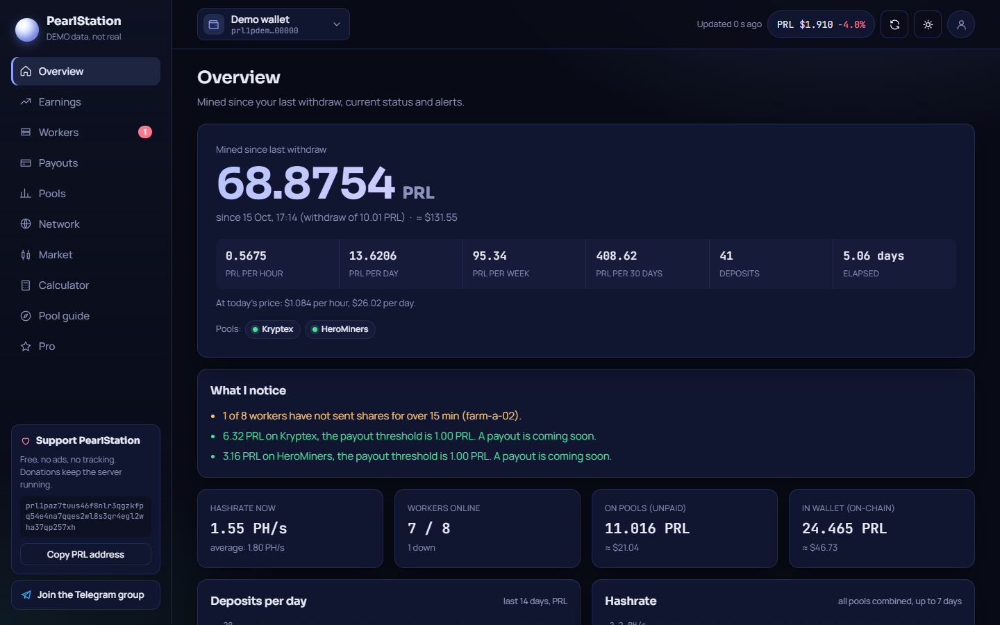
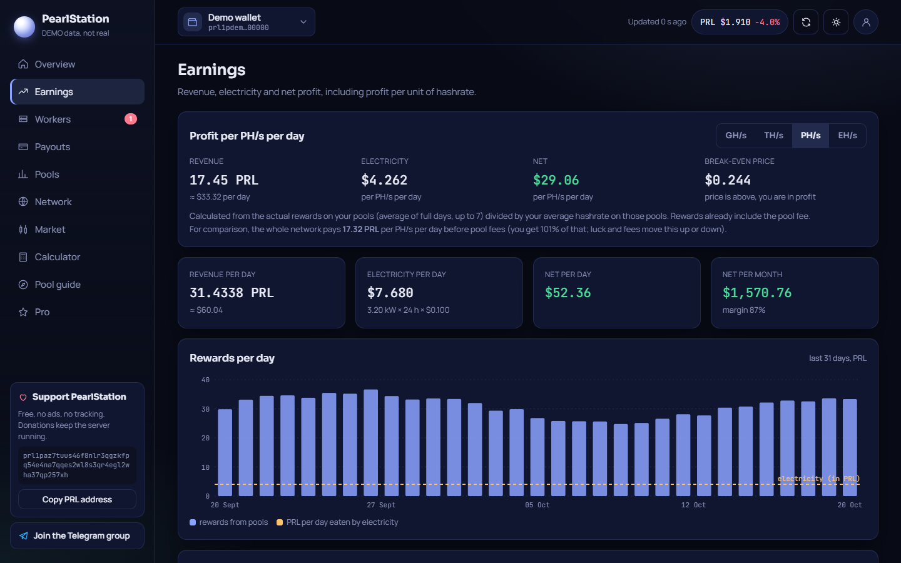
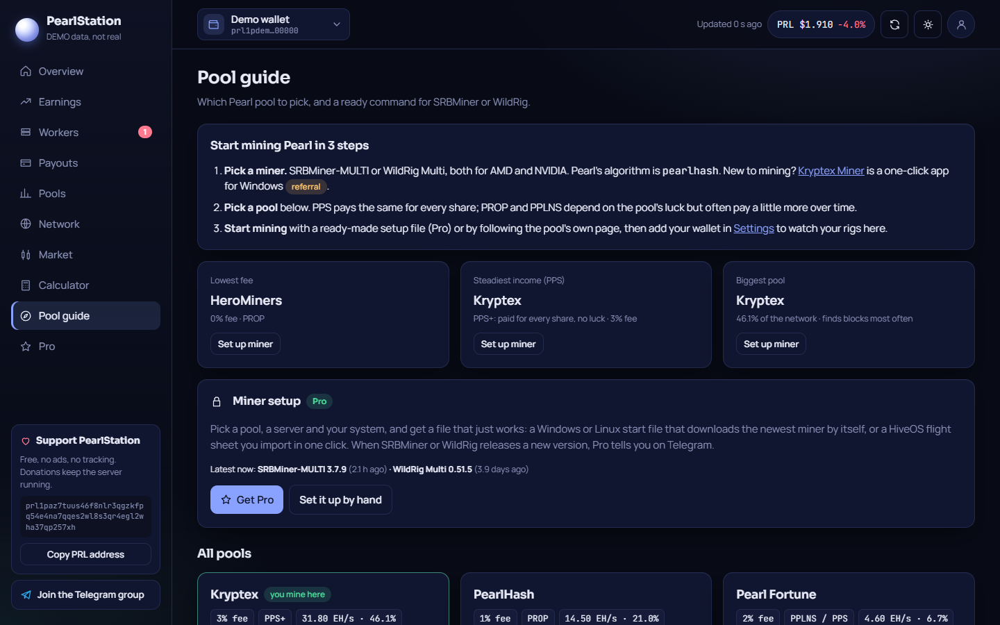
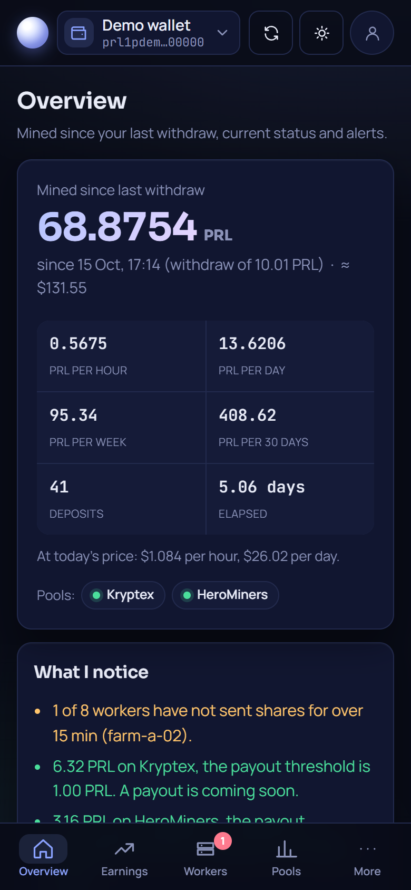
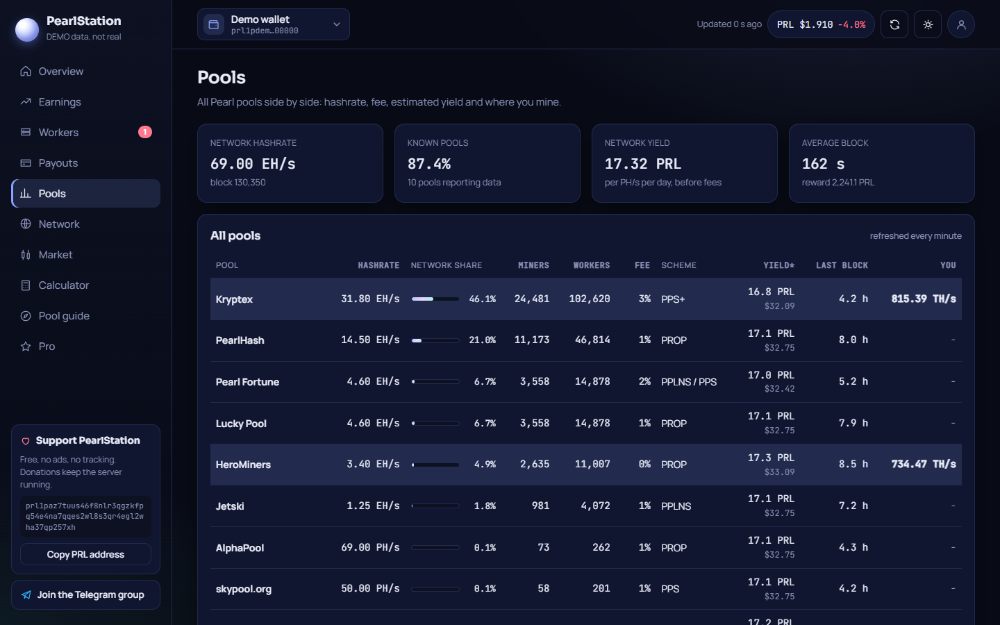
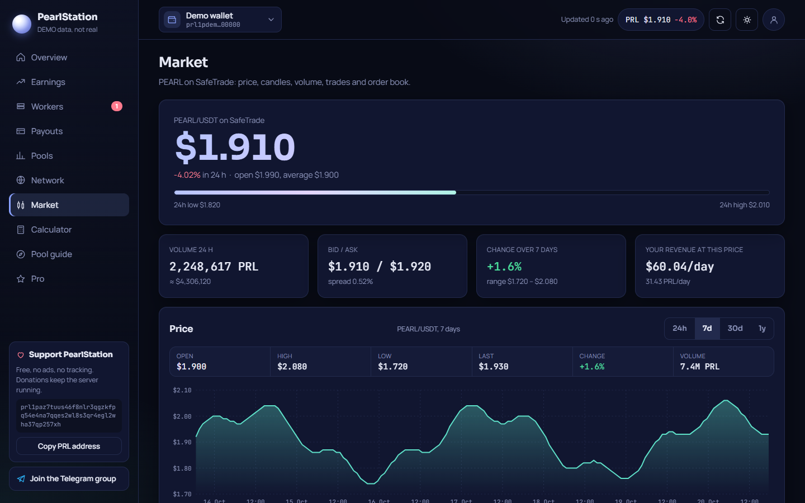

# PearlStation

**A mining dashboard for Pearl (PRL).** Every major pool in one place, your wallet's on-chain history, real profit after power costs, pool comparison and the market. No email, no tracking.

**Open it:** [pearlstation.io](https://pearlstation.io) · **Telegram:** [@PearlStationBot](https://t.me/PearlStationBot)

## Features

**Free**
- **One dashboard for all pools:** Kryptex, PearlHash, Pearl Fortune, Lucky Pool, HeroMiners, Jetski, AlphaPool, skypool.org, BaikalMine and 2Miners. Pools are found automatically from your wallet address.
- **Mined since your last withdraw**, per hour, day, week and month, with what it is worth today.
- **Workers:** online and offline rigs, per pool.
- **Payouts:** every deposit to your wallet, read from the blockchain.
- **Earnings and calculator:** real yield per TH/s, profit after electricity.
- **Pool comparison and pool guide:** fees, payout schemes, minimum payouts, verified stratum servers, the miners each pool supports and its share difficulty settings.
- **Network and market:** network hashrate and difficulty, PRL price, candles, order book.

**Pro** (paid in PRL, verified on chain, no subscription)
- Telegram alerts when a rig goes offline, hashrate drops, a payout arrives or the price crosses a level.
- Daily or weekly report, plus bot commands: `/status`, `/report`, `/alerts`, `/price`, `/miners`.
- Ready-made miner setup: Windows and Linux start files and HiveOS flight sheets, always on the newest SRBMiner-MULTI, BzMiner (also Intel Arc) or WildRig Multi, for the pools that support them, with optional share difficulty and an alert when a new version is out.
- A year of hashrate history and a tax/accounting CSV export.

| Earnings | Pool guide | Phone |
|---|---|---|
|  |  |  |

| Pools | Market |
|---|---|
|  |  |

## Privacy

- No access log, no analytics, no third-party scripts or fonts.
- Without an account, everything stays in your browser.
- With an account: a username and password, no email. The server stores only an HMAC of the username, and the settings are encrypted (AES-256-GCM) with a key that only your password or recovery code can unlock.
- Pro monitoring is opt-in. Turning it off deletes the stored wallet addresses.

Details: [pearlstation.io/privacy](https://pearlstation.io/privacy).

## Changelog

See [CHANGELOG.md](CHANGELOG.md).

## Feedback

Found a bug, a pool that is missing, or have an idea? Open an [issue](../../issues).

## Support

PearlStation is free to use. Donations keep the server running:
`prl1paz7tuus46f8nlr3qgzkfpq54e4na7qqes2wl8s3qr4egl2wha37qp257xh`

---

The PearlStation source code is not public. Copyright (c) 2026 PearlStation. All rights reserved.
